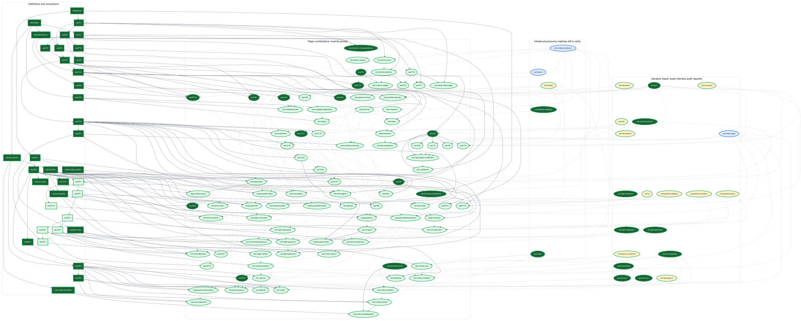

# WPFormalization

A Lean 4 and Mathlib formalization of Li–Wang's [*Uniform large-genus asymptotics of Weil–Petersson volumes*](https://arxiv.org/abs/2610.35492).

**Full dependency graph**

[](docs/assets/dependency-graph.svg)

## Stage one: current results

Stage one is complete: the paper's core proofs have been formalized under explicitly registered classical premises. The formalization covers all 57 numbered results and the registered additional derivations, comprising 92 result targets. Of these, 7 are proved without unproved external inputs, and 85 have conditional proofs. The [target table](docs/TARGETS.md) relates the paper's statements to their Lean declarations.

The project has passed `lake build`, an axiom-dependency audit, and an audit of explicit theorem parameters, with no unregistered uses of `sorry` or additional mathematical axioms found. See the [audit summary](audit/summary.json) and [validation record](audit/validation.json). Some classical proofs, the construction of the intended geometric objects, and their compatibility remain outstanding; the current result is therefore a conditional formalization.

Build with the versions pinned in `lean-toolchain` and `lake-manifest.json`:

```bash
lake exe cache get
lake build
```

Run `./scripts/ci-blueprint.sh` for the full checks; Python 3 and Node.js are also required.

## Interactive Blueprint

After building the project, run the following commands from the repository root:

```bash
lake exe vbp build
python3 scripts/export_blueprint.py
python3 -m http.server 8000 --bind 127.0.0.1 --directory blueprint
```

Open [http://127.0.0.1:8000/](http://127.0.0.1:8000/). The first export requires network access.

## Stage two: remaining work

Stage two aims to remove the unproved external dependencies and obtain complete proofs about the mathematical objects in the paper. The project registers 77 groups of external dependencies: 27 groups contain a total of 38 uses of `sorry`, and 50 groups supply assumptions through explicit interfaces. The remaining work falls into three categories.

### 1. Complete the proofs of classical results

Reuse Mathlib and other existing formalizations wherever possible to prove the required results on intersection numbers, Gamma and Bessel functions, complex analysis, Painlevé I, classical volume estimates, and probability limits. Replace each deferred `sorry` with a proof that respects the registered hypotheses, normalizations, and range of validity.

### 2. Construct the intended mathematical objects and implement the interfaces

Construct the relevant Deligne–Mumford moduli spaces, psi and kappa classes, integration, Weil–Petersson measures, hyperbolic surfaces, geodesics, and spectra. Prove that these objects satisfy the existing abstract interfaces. Declaring an interface does not construct an instance for the intended objects; these constructions are part of stage two.

### 3. Establish compatibility and instantiate the main theorems

Realize the intersection, volume, curve, cutting, spectral, and probability interfaces on a common family of mathematical objects. Prove the required identifications, normalizations, and compatibility results, then instantiate the conditional theorems to recover the paper's geometric conclusions. Finally, repeat the full build, axiom and explicit-premise audits, and comparison of every target with the paper to verify that no unproved mathematical assumptions specific to the project remain.

The following documents organize these tasks:

| Document | Purpose |
| --- | --- |
| [Classical results](docs/CLASSICAL_RESULTS.md) | Records the precise statements, hypotheses, references, and uses of all external dependencies, including deferred proofs and explicit interfaces. |
| [Remaining infrastructure](docs/INFRASTRUCTURE.md) | Lists the outstanding proofs, object constructions, and compatibility requirements for stage two. |

Licensed under the [MIT License](LICENSE).
